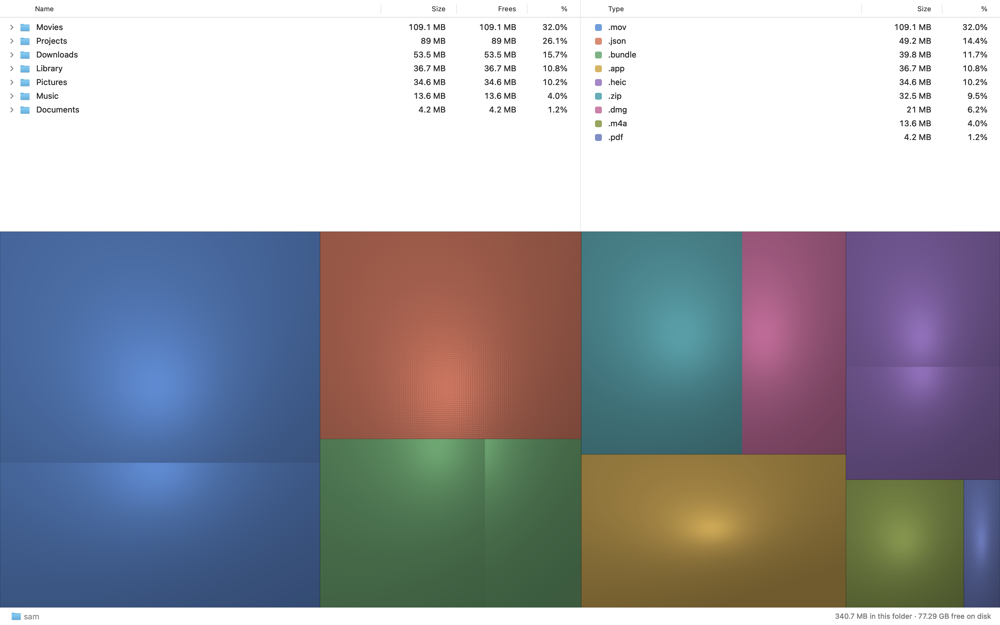
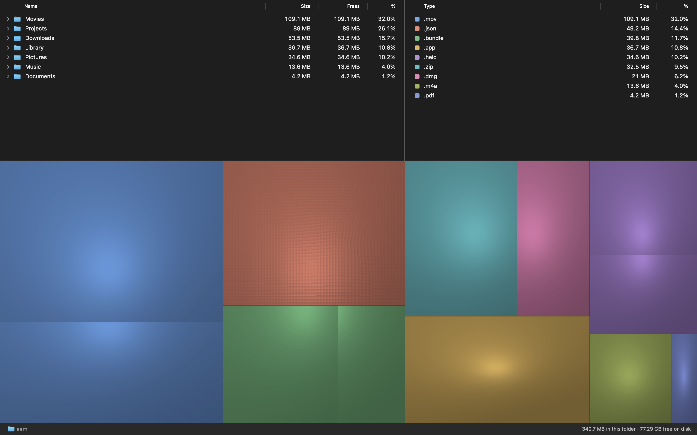

# MacDiskStats

MacDiskStats is a free, strictly read-only disk map for macOS, built as a modern WinDirStat for the Mac. It shows a folder tree, file types, and a cushion treemap of disk use. Select a folder or box to see where space went. You can reveal a file in Finder, copy its path, or use Quick Look. To remove a file, delete it in Finder and then choose Rescan in MacDiskStats.

## Install

Download the DMG from the release page. Open it and drag MacDiskStats to Applications. The app is built for macOS 15 or later. It has been tested on macOS 27 only; macOS 15 and 26 have not been tested.

To build from source on an Apple Silicon Mac with the command-line developer tools installed, run `scripts/build.sh release`. The app is in `build/MacDiskStats.app`. This local build has an ad hoc signature unless you set `MDS_SIGN_ID` to your Developer ID Application identity. The release build uses `swiftc` and does not require Xcode project generation.

## Scan access

You can scan a folder without Full Disk Access. Full Disk Access is optional. Grant it in System Settings if you want the app to read protected folders during a whole-disk scan. Without it, macOS may deny some folders; the app reports unreadable folders instead of treating them as empty. You can revoke access in System Settings.

## Read-only

MacDiskStats scans file metadata. It does not open regular file contents and has no delete, move, or write-file action. Its app sandbox asks macOS for read-only access to disk paths; macOS enforces that limit. Quick Look is provided by macOS. The app never deletes files. Use Finder for deletion.

The map uses allocated bytes, which means disk blocks used by a file, rather than its logical length. Hard-linked names count once. For APFS clones, the first name counts its allocated bytes and later names with the same clone ID count their private bytes. The Frees column is a lower bound from private bytes: removing every member of a clone group in one folder can free more. The status line shows space the scan could not assign, including unreadable folders and file-system data.

## Measured speed

On one MacBook-class M3 with 8 CPU cores, 24 GB of memory, and 3.87 million files, the first rows appeared in 69 ms. The first scan pass took about 31 seconds; exact totals took about 38 seconds more. These are measurements on one warm-cache Mac, not a speed promise. A cold disk or different file mix can change them. APFS has no public central file table like NTFS, so MacDiskStats must walk directories; a whole-disk scan here did not finish in 10 seconds.

## Limits

MacDiskStats does not delete files, find duplicates, compare saved scans, refresh automatically, or explain every byte of file-system overhead. It stops at other mounted volumes and reports folders it cannot read. A Rescan updates the view after you change files in Finder.

## Screenshots

Finished scan, light and dark:

Scan in progress, light and dark:

## License

MIT. See [LICENSE](LICENSE).
